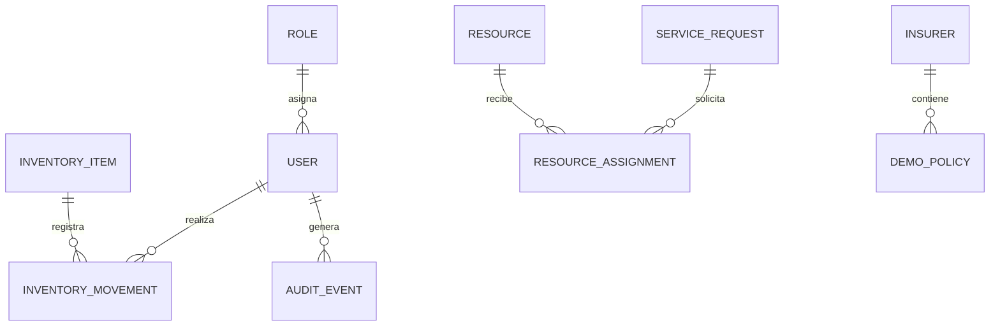

# Serena — Modelo conceptual de datos

**Versión:** 0.1  
**Estado:** Propuesta para revisión  
**Base de datos prevista:** PostgreSQL  
**Acceso a datos previsto:** Drizzle ORM

## 1. Objetivo

Definir las entidades principales de Serena, sus responsabilidades y las relaciones necesarias para implementar los requisitos funcionales.

Este documento describe el diseño conceptual. No representa tablas implementadas ni migraciones ejecutadas.

## 2. Principios de diseño

- Cada entidad tendrá una clave primaria.
- Las relaciones deberán proteger la integridad referencial.
- Los datos persistentes estarán almacenados en PostgreSQL.
- Las operaciones sensibles deberán validarse en el backend.
- Se conservará el historial de movimientos de inventario.
- Los datos de demostración serán ficticios.
- Las contraseñas nunca se almacenarán en texto plano.
- Los registros de auditoría no incluirán secretos ni información innecesaria.
- Los datos personales se limitarán a lo necesario para el alcance académico.

## 3. Entidades propuestas

### 3.1 User — Usuario

Representa a una persona con cuenta en el sistema.

Campos conceptuales:
- `id`: identificador único.
- `name`: nombre de demostración.
- `email`: correo utilizado para iniciar sesión o contactar, si corresponde.
- `passwordHash`: hash seguro de la contraseña, si se utiliza autenticación local.
- `roleId`: referencia al rol.
- `isActive`: indica si la cuenta está habilitada.
- `createdAt`: fecha de creación.
- `updatedAt`: fecha de actualización.

Restricciones:
- El correo deberá cumplir las reglas de unicidad definidas.
- Las contraseñas no se guardarán en texto plano.
- Los campos definitivos dependerán del mecanismo de autenticación seleccionado.

### 3.2 Role — Rol

Representa un conjunto de permisos.

Campos conceptuales:
- `id`: identificador único.
- `name`: nombre del rol.
- `description`: descripción del rol.

Roles iniciales por evaluar:
- Administrador.
- Empleado.
- Consulta restringida, si resulta necesaria.

La autorización efectiva se comprobará en el backend.

### 3.3 Resource — Recurso

Representa un recurso operativo que puede utilizarse para prestar un servicio.

Campos conceptuales:
- `id`: identificador único.
- `name`: nombre del recurso.
- `type`: tipo de recurso.
- `description`: descripción.
- `status`: estado operativo.
- `createdAt`: fecha de creación.
- `updatedAt`: fecha de actualización.

Ejemplos de tipos:
- Sala.
- Vehículo.
- Equipo.
- Otro recurso aprobado para el alcance.

Los tipos y estados definitivos deben validarse con las necesidades de la funeraria.

### 3.4 InventoryItem — Artículo de inventario

Representa un artículo cuya existencia se controla por cantidad.

Campos conceptuales:
- `id`: identificador único.
- `name`: nombre del artículo.
- `category`: categoría.
- `description`: descripción.
- `quantity`: existencia actual, según la unidad definida.
- `unit`: unidad de medida.
- `minimumQuantity`: nivel mínimo de referencia.
- `isActive`: indica si el artículo sigue en uso.
- `createdAt`: fecha de creación.
- `updatedAt`: fecha de actualización.

Ejemplos:
- Ataúdes o cofres.
- Urnas.
- Materiales.
- Equipos consumibles, si corresponde.

La forma de controlar artículos serializados o unidades individuales deberá definirse antes de implementar inventario avanzado.

### 3.5 InventoryMovement — Movimiento de inventario

Registra una entrada, salida o ajuste autorizado.

Campos conceptuales:
- `id`: identificador único.
- `inventoryItemId`: artículo relacionado.
- `type`: tipo de movimiento.
- `quantity`: cantidad del movimiento.
- `reason`: motivo.
- `performedByUserId`: usuario responsable.
- `createdAt`: fecha del movimiento.

Reglas:
- La cantidad debe ser válida y positiva; el tipo define si suma, resta o ajusta.
- Cada movimiento debe conservarse en el historial.
- El cambio de existencia y el registro del movimiento deben mantenerse consistentes.
- Los ajustes deben estar autorizados y justificados.

### 3.6 ServiceRequest — Solicitud de servicio

Representa una solicitud iniciada por un cliente o registrada por personal autorizado.

Campos conceptuales:
- `id`: identificador interno.
- `referenceCode`: referencia pública o de consulta, con protección adecuada.
- `requesterName`: nombre de demostración del solicitante, cuando sea necesario.
- `requesterContact`: contacto ficticio, cuando sea necesario.
- `serviceType`: tipo de servicio solicitado.
- `status`: estado actual.
- `notes`: observaciones limitadas a lo necesario.
- `createdAt`: fecha de creación.
- `updatedAt`: fecha de actualización.

Reglas:
- La referencia deberá ser única y difícil de adivinar si se utiliza para localizar solicitudes.
- La referencia no sustituye un mecanismo de autorización.
- El estado inicial debe ser explícito.
- Registrar una solicitud no implica confirmar el servicio.
- Los cambios de estado deben respetar las transiciones autorizadas.

### 3.7 ResourceAssignment — Asignación de recurso

Relaciona una solicitud con un recurso durante un período.

Campos conceptuales:
- `id`: identificador único.
- `serviceRequestId`: solicitud relacionada.
- `resourceId`: recurso asignado.
- `startAt`: inicio del período.
- `endAt`: final del período.
- `status`: estado de la asignación.
- `assignedByUserId`: usuario que realizó la asignación, cuando corresponda.
- `createdAt`: fecha de creación.

Reglas:
- El período debe ser válido.
- Se debe comprobar la disponibilidad en el backend.
- No se deben permitir asignaciones incompatibles para el mismo recurso.
- Las comprobaciones deben contemplar operaciones concurrentes.
- Las asignaciones canceladas no deben bloquear recursos si las reglas indican que están liberados.

### 3.8 Insurer — Aseguradora de demostración

Representa una aseguradora ficticia utilizada para la demostración.

Campos conceptuales:
- `id`: identificador único.
- `name`: nombre ficticio.
- `isDemoData`: indicador de registro de demostración.

No representa una integración con una aseguradora real.

### 3.9 DemoPolicy — Póliza ficticia

Representa una póliza ficticia para demostrar una consulta.

Campos conceptuales:
- `id`: identificador único.
- `policyCode`: código ficticio de la póliza.
- `insurerId`: aseguradora ficticia relacionada.
- `demoStatus`: estado ficticio de demostración.
- `isDemoData`: indicador de datos ficticios.

Reglas:
- Los registros deben estar identificados como demostrativos.
- No deben presentarse como validaciones reales.
- La respuesta solo debe incluir los campos necesarios.

### 3.10 AuditEvent — Evento de auditoría

Registra operaciones relevantes para revisión.

Campos conceptuales:
- `id`: identificador único.
- `userId`: usuario relacionado, si corresponde.
- `action`: tipo de operación.
- `entityType`: tipo de entidad afectada.
- `entityId`: identificador del registro afectado, cuando corresponda.
- `createdAt`: fecha del evento.
- `details`: información limitada y segura sobre la operación.

Reglas:
- No registrar contraseñas, claves API ni tokens.
- Limitar el acceso a los registros.
- Definir la política de conservación antes de utilizar datos reales.

### 3.11 AgentToolLog — Registro de herramientas del agente

Registra la ejecución de herramientas del agente cuando sea necesario para depuración y auditoría.

Campos conceptuales:
- `id`: identificador único.
- `toolName`: nombre de la herramienta.
- `status`: resultado de la ejecución.
- `requestId`: identificador de correlación, cuando corresponda.
- `createdAt`: fecha de ejecución.
- `safeErrorCode`: código de error seguro, si ocurre un fallo.

No se deben registrar secretos ni conversaciones completas por defecto. La necesidad de conservar mensajes deberá evaluarse por separado.

## 4. Relaciones principales

- Un rol puede estar asociado a muchos usuarios.
- Un artículo de inventario puede tener muchos movimientos.
- Un usuario autorizado puede realizar muchos movimientos de inventario.
- Una solicitud puede tener varias asignaciones a recursos.
- Un recurso puede aparecer en muchas asignaciones a lo largo del tiempo.
- Una aseguradora ficticia puede tener muchas pólizas ficticias.
- Un usuario puede estar relacionado con muchos eventos de auditoría.
- Una ejecución del agente puede producir uno o más registros de herramientas.

## 5. Diagrama conceptual

El siguiente diagrama representa las relaciones principales. Es conceptual y debe revisarse antes de implementar las tablas.

## 6. Decisiones pendientes

- Definir si se necesita una entidad separada para clientes.
- Definir el mecanismo de autenticación y las tablas relacionadas.
- Establecer los estados y las transiciones de las solicitudes.
- Definir cómo se gestionan los recursos sin cantidad, como salas y vehículos.
- Determinar si los artículos de inventario necesitan lotes o unidades individuales.
- Establecer la política de conservación de registros de auditoría.
- Decidir qué datos del agente se registrarán.
- Definir las restricciones para evitar asignaciones simultáneas incompatibles.
- Establecer las reglas de privacidad y los datos mínimos necesarios.

## 7. Criterios de aceptación

El modelo estará listo para implementarse cuando:
1. Las entidades cubran los requisitos aprobados.
2. Las relaciones y restricciones estén definidas.
3. Se hayan revisado las reglas de disponibilidad e inventario.
4. Se hayan establecido los permisos y los datos mínimos.
5. El modelo haya sido revisado con los casos de uso.
6. Se pueda traducir a tablas y migraciones sin ambigüedades importantes.
