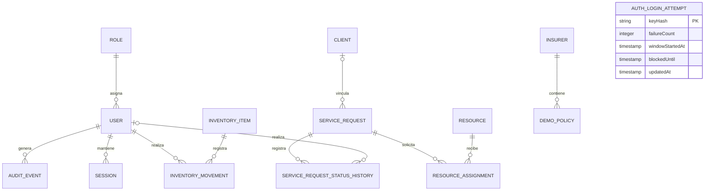

# Serena — Modelo conceptual de datos

**Versión:** 0.2  
**Estado:** Autenticación implementada; las demás entidades siguen siendo conceptuales  
**Base de datos prevista:** PostgreSQL  
**Acceso a datos previsto:** Drizzle ORM

## 1. Objetivo

Definir las entidades principales de Serena, sus responsabilidades y las relaciones necesarias para implementar los requisitos funcionales.

Este documento describe el diseño conceptual del dominio. Las tablas de autenticación, roles, sesiones y limitación de intentos ya están implementadas en PostgreSQL; las demás entidades siguen siendo propuestas.

## 2. Principios de diseño

- Cada entidad tendrá una clave primaria.
- Las relaciones deberán proteger la integridad referencial.
- Los datos persistentes estarán almacenados en PostgreSQL.
- Las operaciones sensibles deberán validarse en el backend.
- Se conservará el historial de movimientos de inventario.
- Los datos de demostración serán ficticios.
- Las contraseñas nunca se almacenarán en texto plano.
- Los registros de auditoría no incluirán secretos ni información innecesaria.
- Los datos personales se limitarán a lo necesario para el alcance académico.

## 3. Entidades propuestas

### 3.1 User — Usuario

Representa a una persona autorizada para acceder al panel privado de Serena.

Campos conceptuales:
- `id`: identificador único (UUID).
- `fullName`: nombre completo del usuario.
- `email`: correo electrónico utilizado para iniciar sesión.
- `passwordHash`: hash scrypt de la contraseña con sal aleatoria.
- `roleId`: referencia al rol asignado.
- `isActive`: indica si la cuenta está habilitada.
- `mustChangePassword`: indica si debe cambiar la contraseña en el próximo acceso.
- `createdAt`: fecha de creación.
- `updatedAt`: fecha de última actualización.
- `lastLoginAt`: fecha del último inicio de sesión, si existe.

Restricciones:
- El correo electrónico será único.
- El correo se normalizará sin espacios y en minúsculas.
- Cada usuario tendrá exactamente un rol.
- Las contraseñas nunca se almacenarán en texto plano.
- Los usuarios desactivados no podrán iniciar sesión.
- Desactivar una cuenta no eliminará sus registros históricos.
- Al desactivar una cuenta se revocarán todas sus sesiones activas.
- Al cambiar la contraseña se revocarán las demás sesiones activas del usuario.

### 3.2 Role — Rol

Representa el perfil de autorización de un usuario.

Campos conceptuales:
- `id`: nombre único del rol (`administrador` o `empleado`).
- `description`: descripción de sus responsabilidades.

Roles iniciales:
- `administrador`: administra usuarios, roles, recursos, inventario y operaciones autorizadas.
- `empleado`: consulta y actualiza operaciones según los permisos asignados.

Restricciones:
- Cada usuario tendrá exactamente un rol.
- Un mismo rol podrá estar asignado a varios usuarios.
- La autorización efectiva se comprobará en el backend.
- No habrá registro público de usuarios.
- Solo el administrador podrá crear cuentas de empleados.

### 3.3 Session — Sesión

Representa una sesión autenticada de un usuario en el panel privado de Serena.

Campos conceptuales:
- `id`: identificador único.
- `userId`: referencia al usuario propietario de la sesión.
- `tokenHash`: hash seguro del token de sesión.
- `createdAt`: fecha de creación.
- `lastActivityAt`: fecha de última actividad.
- `expiresAt`: fecha límite de expiración.

Restricciones:
- Las sesiones se almacenarán en PostgreSQL.
- El token original no se almacenará en la base de datos.
- `tokenHash` almacenará el SHA-256 del token aleatorio de sesión.
- La duración máxima inicial será de 8 horas.
- Las sesiones expirarán después de 30 minutos de inactividad.
- Al cerrar sesión se revocará la sesión correspondiente.
- Al desactivar un usuario se revocarán todas sus sesiones activas.
- Al cambiar la contraseña se revocarán las demás sesiones activas.
- Las sesiones expiradas o revocadas no permitirán acceder al panel privado.

### 3.4 Resource — Recurso

Representa un recurso operativo que puede utilizarse para prestar un servicio.

Campos conceptuales:
- `id`: identificador único.
- `name`: nombre del recurso.
- `type`: tipo de recurso.
- `description`: descripción.
- `status`: estado operativo.
- `createdAt`: fecha de creación.
- `updatedAt`: fecha de actualización.

Ejemplos de tipos:
- Sala.
- Vehículo.
- Equipo.
- Otro recurso aprobado para el alcance.

Los tipos y estados definitivos deben validarse con las necesidades de la funeraria.

Reglas:
- Cada registro representa un recurso individual e identificable.
- Cada recurso tiene su propio estado operativo.
- Su disponibilidad depende de su estado operativo y de las asignaciones vigentes.
- Los recursos reutilizables que deban identificarse individualmente se registran aquí, no como existencias cuantificables.

### 3.5 InventoryItem — Artículo de inventario

Representa un artículo cuya existencia se controla por cantidad.

Campos conceptuales:
- `id`: identificador único.
- `name`: nombre del artículo.
- `category`: categoría.
- `description`: descripción.
- `quantity`: existencia actual, según la unidad definida.
- `unit`: unidad de medida.
- `minimumQuantity`: nivel mínimo de referencia.
- `isActive`: indica si el artículo sigue en uso.
- `createdAt`: fecha de creación.
- `updatedAt`: fecha de actualización.

Ejemplos:
- Ataúdes o cofres.
- Urnas.
- Materiales.
- Equipos consumibles, si corresponde.

Reglas:
- La existencia se controla mediante cantidades y unidades de medida.
- Las entradas, salidas y ajustes deben registrarse mediante InventoryMovement.
- Los artículos consumibles se gestionan en esta entidad.
- Los bienes reutilizables e identificables individualmente se gestionan en Resource.

La forma de controlar artículos serializados o unidades individuales deberá definirse antes de implementar inventario avanzado.

### 3.6 InventoryMovement — Movimiento de inventario

Registra una entrada, salida o ajuste autorizado.

Campos conceptuales:
- `id`: identificador único.
- `inventoryItemId`: artículo relacionado.
- `type`: tipo de movimiento.
- `quantity`: cantidad del movimiento.
- `reason`: motivo.
- `performedByUserId`: usuario responsable.
- `createdAt`: fecha del movimiento.

Reglas:
- La cantidad debe ser válida y positiva; el tipo define si suma, resta o ajusta.
- Cada movimiento debe conservarse en el historial.
- El cambio de existencia y el registro del movimiento deben mantenerse consistentes.
- Los ajustes deben estar autorizados y justificados.

### 3.7 Client — Cliente

Representa a una persona que solicita uno o varios servicios funerarios.

Campos conceptuales:
- `id`: identificador único.
- `fullName`: nombre completo.
- `contactPhone`: teléfono de contacto.
- `email`: correo electrónico, opcional.
- `createdAt`: fecha de creación.
- `updatedAt`: fecha de última actualización.

Restricciones:
- No necesita una cuenta ni contraseña para solicitar servicios.
- Puede estar asociado a varias solicitudes.
- Solo se almacenarán los datos personales necesarios para gestionar el servicio.

### 3.8 ServiceRequest — Solicitud de servicio

Representa una solicitud iniciada por un cliente o registrada por personal autorizado.

Campos conceptuales:
- `id`: identificador interno.
- `referenceCode`: referencia pública o de consulta, con protección adecuada.
- `clientId`: referencia opcional al cliente registrado.
- `requesterName`: nombre de demostración del solicitante, cuando sea necesario.
- `requesterContact`: contacto ficticio, cuando sea necesario.
- `serviceType`: tipo de servicio solicitado.
- `status`: estado actual.
- `notes`: observaciones limitadas a lo necesario.
- `createdAt`: fecha de creación.
- `updatedAt`: fecha de actualización.

Reglas:
- La solicitud podrá registrarse sin una ficha permanente de cliente.
- Cuando no exista un cliente registrado, se conservarán los datos mínimos de contacto del solicitante.
- Una solicitud podrá vincularse posteriormente a una ficha de cliente mediante un proceso autorizado.
- La referencia deberá ser única y difícil de adivinar si se utiliza para localizar solicitudes.
- La referencia no sustituye un mecanismo de autorización.
- El estado inicial debe ser explícito.
- Registrar una solicitud no implica confirmar el servicio.
- Los cambios de estado deben respetar las transiciones autorizadas.

### 3.9 ServiceRequestStatusHistory — Historial de estados de solicitudes

Registra cada cambio de estado de una solicitud para conservar su trazabilidad.

Campos conceptuales:
- `id`: identificador único del registro.
- `serviceRequestId`: solicitud a la que pertenece el cambio.
- `previousStatus`: estado anterior; será nulo en el registro inicial.
- `newStatus`: nuevo estado asignado.
- `changedByUserId`: usuario responsable del cambio; podrá ser nulo cuando el cambio corresponda al registro inicial automático de la solicitud.
- `reason`: motivo del cambio, obligatorio para rechazos y cancelaciones.
- `createdAt`: fecha y hora del cambio.

Reglas:
- Una solicitud podrá tener múltiples registros históricos.
- Cada registro pertenecerá a una sola solicitud.
- La creación de una solicitud generará un registro inicial con `previousStatus` nulo y `newStatus` igual a `pendiente`.
- Cada cambio de estado autorizado generará un nuevo registro.
- El historial no se sobrescribirá ni eliminará mediante las operaciones normales de la aplicación.
- Los cambios deberán registrar el usuario responsable y la fecha y hora.
- El backend validará las transiciones permitidas antes de registrar cada cambio.
- El motivo será obligatorio para los rechazos y las cancelaciones.

### 3.10 ResourceAssignment — Asignación de recurso

Relaciona una solicitud con un recurso durante un período.

Campos conceptuales:
- `id`: identificador único.
- `serviceRequestId`: solicitud relacionada.
- `resourceId`: recurso asignado.
- `startAt`: inicio del período.
- `endAt`: final del período.
- `status`: estado de la asignación.
- `assignedByUserId`: usuario que realizó la asignación, cuando corresponda.
- `createdAt`: fecha de creación.

Reglas:
- El período debe ser válido.
- Se debe comprobar la disponibilidad en el backend.
- No se deben permitir asignaciones incompatibles para el mismo recurso.
- Las comprobaciones deben contemplar operaciones concurrentes.
- Las asignaciones canceladas no deben bloquear recursos si las reglas indican que están liberados.

### 3.11 Insurer — Aseguradora de demostración

Representa una aseguradora ficticia utilizada para la demostración.

Campos conceptuales:
- `id`: identificador único.
- `name`: nombre ficticio.
- `isDemoData`: indicador de registro de demostración.

No representa una integración con una aseguradora real.

### 3.12 DemoPolicy — Póliza ficticia

Representa una póliza ficticia para demostrar una consulta.

Campos conceptuales:
- `id`: identificador único.
- `policyCode`: código ficticio de la póliza.
- `insurerId`: aseguradora ficticia relacionada.
- `demoStatus`: estado ficticio de demostración.
- `isDemoData`: indicador de datos ficticios.

Reglas:
- Los registros deben estar identificados como demostrativos.
- No deben presentarse como validaciones reales.
- La respuesta solo debe incluir los campos necesarios.

### 3.13 AuditEvent — Evento de auditoría

Registra operaciones relevantes para revisión.

Campos conceptuales:
- `id`: identificador único.
- `userId`: usuario relacionado, si corresponde.
- `action`: tipo de operación.
- `entityType`: tipo de entidad afectada.
- `entityId`: identificador del registro afectado, cuando corresponda.
- `createdAt`: fecha del evento.
- `details`: información limitada y segura sobre la operación.

Reglas:
- No registrar contraseñas, claves API ni tokens.
- Limitar el acceso a los registros.
- Definir la política de conservación antes de utilizar datos reales.

### 3.14 AgentToolLog — Registro de herramientas del agente

Registra la ejecución de herramientas del agente cuando sea necesario para depuración y auditoría.

Campos conceptuales:
- `id`: identificador único.
- `toolName`: nombre de la herramienta.
- `status`: resultado de la ejecución.
- `requestId`: identificador de correlación, cuando corresponda.
- `createdAt`: fecha de ejecución.
- `safeErrorCode`: código de error seguro, si ocurre un fallo.

No se deben registrar secretos ni conversaciones completas por defecto. La necesidad de conservar mensajes deberá evaluarse por separado.

### 3.15 AuthLoginAttempt — Control de intentos de autenticación

Almacena únicamente los contadores necesarios para limitar intentos de inicio de sesión.

Campos implementados:
- `keyHash`: HMAC de un identificador de correo o dirección IP; no conserva el dato original.
- `failureCount`: intentos fallidos dentro de la ventana.
- `windowStartedAt`: inicio de la ventana de 15 minutos.
- `blockedUntil`: fin del bloqueo temporal, si se alcanzó el límite.
- `updatedAt`: fecha del último intento registrado.

Reglas implementadas:
- Se permiten hasta cinco fallos por identificador o dirección IP antes de bloquear nuevos intentos durante 15 minutos.
- Las claves HMAC utilizan `SESSION_SECRET`.
- Los registros antiguos se eliminan después de 24 horas.

## 4. Relaciones principales

- Un rol puede estar asociado a muchos usuarios.
- Cada usuario tendrá exactamente un rol.
- Un usuario puede tener muchas sesiones.
- Cada sesión pertenece a un único usuario.
- Un cliente puede estar asociado a muchas solicitudes.
- Una solicitud puede estar vinculada a cero o un cliente mediante `clientId`.
- Una solicitud puede registrarse sin una ficha permanente de cliente.
- Una solicitud puede tener muchos registros históricos de estado.
- Cada registro histórico pertenece a una única solicitud.
- Un usuario puede realizar muchos cambios de estado en solicitudes.
- El usuario responsable de un registro histórico puede ser nulo cuando se trate del registro inicial automático.
- Un artículo de inventario puede tener muchos movimientos.
- Un usuario autorizado puede realizar muchos movimientos de inventario.
- Una solicitud puede tener varias asignaciones a recursos.
- Un recurso puede aparecer en muchas asignaciones a lo largo del tiempo.
- Una aseguradora ficticia puede tener muchas pólizas ficticias.
- Un usuario puede estar relacionado con muchos eventos de auditoría.
- Una ejecución del agente puede producir uno o más registros de herramientas.

## 5. Diagrama conceptual

El siguiente diagrama representa las relaciones principales. Es conceptual y debe revisarse antes de implementar las tablas.

## 6. Decisiones pendientes

- Definir cómo se gestionan los recursos sin cantidad, como salas y vehículos.
- Determinar si los artículos de inventario necesitan lotes o unidades individuales.
- Establecer la política de conservación de registros de auditoría.
- Decidir qué datos del agente se registrarán.
- Definir las restricciones para evitar asignaciones simultáneas incompatibles.
- Establecer las reglas de privacidad y los datos mínimos necesarios.

## 7. Criterios de aceptación

El modelo estará listo para implementarse cuando:

1. Las entidades cubran los requisitos aprobados.
2. Las relaciones y restricciones estén definidas.
3. Se hayan revisado las reglas de disponibilidad e inventario.
4. Se hayan establecido los permisos y los datos mínimos.
5. El modelo contemple la autenticación, los roles y la gestión de sesiones.
6. Las solicitudes puedan registrarse con o sin una ficha permanente de cliente.
7. Se hayan definido las reglas de privacidad y protección de datos personales.
8. El modelo haya sido revisado con los casos de uso.
9. Se pueda traducir a tablas y migraciones sin ambigüedades importantes.
